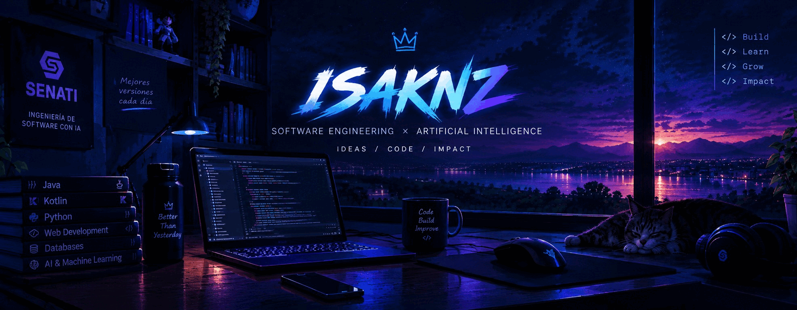

<div align="center">

  <!-- Banner -->
  

  <br><br>

  <!-- Typing SVG -->
  

  <br><br>

  <!-- Redes sociales -->
  <a href="https://github.com/Isaknz">
    
  </a>
  <a href="https://tiktok.com/@isa_acnxx">
    
  </a>
  <a href="https://youtube.com/@issc_nxz">
    
  </a>
  <a href="https://www.instagram.com/isa_acnxx">
    
  </a>
  <a href="https://www.facebook.com/profile.php?id=100088112583941">
    
  </a>

  <br><br>

  <!-- Email -->
  <a href="mailto:isaacperezas@gmail.com">
    
  </a>

</div>

---

## `> Sobre mí`

Soy estudiante de **Ingeniería de Software** interesado en crear soluciones claras, funcionales y útiles.

Me gusta aprender construyendo proyectos relacionados con:


> `Ideas → Code → Impact`

---

## `> Tech stack`

<div align="center">


</div>

---

## `> Proyectos destacados`

<table>
<tr>
<td width="50%">

### 📩 Next Level School
Ingresos y Egresos de Colegio Académico


<a href="https://github.com/Isaknz/NEXT_LEVEL.git">

</a>

</td>

<td width="50%">

### ⚡ Streaming

Proyecto académico enfocado en la gestión de peliculas y series.

<a href="https://github.com/Isaknz/streamingfilm.git">

</a>

</td>
</tr>

<tr>
<td width="50%">

### ✅ Elite Dental

Proyecto académico relacionado con la gestión de pacientes de una clínica dental.

<a href="https://github.com/Isaknz/ELITEDENTAL.git">

</a>

</td>

<td width="50%">

### 🚀 Próximamente

Nuevos proyectos, experimentos y soluciones en construcción.

</td>
</tr>
</table>

---

## `> Actualmente aprendiendo`

```text
Machine Learning       ███████████████░░░
Desarrollo web         █████████████░░░░░
Arquitectura           ███████████░░░░░░░
Ingeniería de software ██████████████░░░░
