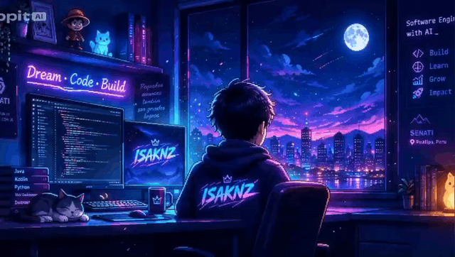

  <!-- Banner -->
  

    

  <!-- Typing SVG -->
  

    

  <!-- Redes sociales -->
  
  
  
  
  
  

---

## `> Sobre mí`

Soy estudiante de **Ingeniería de Software** interesado en crear soluciones claras, funcionales y útiles.

Me gusta aprender construyendo proyectos relacionados con:

  
  
  
  
  

> `Ideas → Code → Impact`

---

## `> Tech stack`

---

## `> Estadísticas de GitHub`

  
  

---

## `> Proyectos destacados`

<table>
<tr>
<td width="50%">

### 📩 Next Level School
Ingresos y Egresos de Colegio Académico

</td>

<td width="50%">

### ⚡ Streaming
Proyecto académico enfocado en la gestión de películas y series.

</td>
</tr>

<tr>
<td width="50%">

### ✅ Elite Dental
Proyecto académico relacionado con la gestión de pacientes de una clínica dental.

</td>

<td width="50%">

### 🚀 Próximamente
Nuevos proyectos, experimentos y soluciones en construcción.

</td>
</tr>
</table>

---

## `> Actualmente aprendiendo`

    
    
    
  

 

  <i>⭐ ¡Gracias por visitar mi perfil! ⭐</i>

